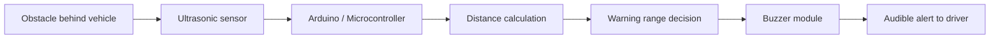

# Automatic Reverse Car Parking Alarm Sensor

## Project Overview

The Automatic Reverse Car Parking Alarm Sensor is an embedded-system project designed to assist drivers while reversing into a parking space. It detects obstacles behind the vehicle using ultrasonic distance sensing and gives an audible warning through a buzzer. The alert becomes more frequent as the obstacle gets closer, helping the driver judge the available space.

The main idea is simple: **measure the distance, interpret how close the obstacle is, and give the driver a clear sound alert.**

> **Implementation note:** The repository originally contained no source code or circuit files. The Arduino sketch and wiring notes included here are a reference implementation using one HC-SR04 sensor, an Arduino Uno and a buzzer. Your supplied project description refers to ultrasonic sensors in general; if your original build used multiple sensors or a different controller, update the pin map and code to match the actual prototype before presenting it as the final hardware design.

## Project Details

| Item | Details |
|---|---|
| Project name | Automatic Reverse Car Parking Alarm Sensor |
| Project area | Embedded Systems / Vehicle Parking Assistance |
| Main function | Detect obstacles and provide distance-based audible alerts |
| Controller | Arduino / compatible microcontroller |
| Sensing | Ultrasonic distance sensor(s) |
| Alert | Buzzer module |
| Programming | Embedded C/C++ |
| Team role | Team Leader |

## Problem Statement

When reversing a vehicle, objects behind it may be difficult to see, especially in narrow parking spaces or areas with limited visibility. This can make it harder to estimate the remaining distance and may lead to accidental contact with an obstacle.

This project explores a low-cost electronic aid that measures the distance to an obstacle and provides an audible indication when the vehicle approaches it.

## Objectives

- Detect objects behind the vehicle using ultrasonic sensing.
- Estimate the distance between the sensor and an obstacle.
- Provide audible alerts at different distance ranges.
- Make the warning faster as the obstacle gets closer.
- Build and test a working embedded-system prototype.
- Coordinate the project work, schedule and resources as a team.

## How the System Works

1. The microcontroller starts the sensor and buzzer.
2. The ultrasonic sensor sends a trigger pulse.
3. The sensor receives the reflected echo from an object.
4. The controller measures the echo time and estimates the distance.
5. The measured distance is compared with the programmed warning ranges.
6. The buzzer provides the corresponding alert.
7. The process repeats while the system is operating.

### System Block Diagram



## Main Components

The following is a suggested bill of materials for the reference circuit. Confirm the exact parts and quantities against your physical project.

| Component | Purpose | Example quantity |
|---|---|---:|
| Arduino Uno or compatible board | Reads sensor data and controls the buzzer | 1 |
| HC-SR04 ultrasonic sensor | Measures obstacle distance | 1 for the reference sketch |
| Active buzzer module | Gives audible warning | 1 |
| Breadboard / prototype board | Holds circuit connections | 1 |
| Jumper wires | Connects the components | As required |
| USB cable / regulated supply | Powers the bench prototype | 1 |

If the actual project uses more than one ultrasonic sensor, the controller code, wiring table and component quantity must be updated accordingly.

## Reference Circuit Connections

These connections match the example sketch at `arduino/parking_alarm/parking_alarm.ino`.

| Component pin | Arduino Uno |
|---|---|
| HC-SR04 VCC | 5V |
| HC-SR04 GND | GND |
| HC-SR04 TRIG | Digital pin 9 |
| HC-SR04 ECHO | Digital pin 10 |
| Buzzer positive (+) | Digital pin 6 |
| Buzzer negative (-) | GND |

Check the datasheets and current requirements of the actual components. A buzzer that draws more current than a GPIO pin can safely provide must be driven through a suitable transistor circuit.

## Example Alert Ranges

The example sketch uses these adjustable ranges to demonstrate proximity-based alerts.

| Distance to obstacle | Example buzzer response |
|---|---|
| More than 150 cm | No warning |
| 101–150 cm | Slow beeping |
| 51–100 cm | Medium beeping |
| 21–50 cm | Fast beeping |
| 20 cm or less | Continuous tone |

These are sample thresholds, not measured project results or universal parking-sensor standards. They should be calibrated and tested with the actual sensor position and vehicle geometry.

## Technologies Used

- Ultrasonic sensors
- Arduino / Microcontroller
- Embedded C/C++
- Buzzer module
- Project planning and management tools

## Team Role and Responsibilities

**Role: Team Leader**

- Coordinated the team and divided project tasks based on the work required.
- Prepared and maintained the project plan and schedule.
- Helped track the project budget and component requirements.
- Guided the design, development and integration activities.
- Coordinated sensor, controller and buzzer testing.
- Followed up on issues and helped the team complete the planned work.

## Software and Setup

### Requirements

- Arduino IDE (2.x recommended)
- Arduino Uno or compatible board support
- USB data cable
- The components used by the selected circuit

The example sketch uses Arduino's built-in functions and does not require an additional library.

### Upload the Example Sketch

1. Install and open the Arduino IDE.
2. Connect the Arduino board to the computer using USB.
3. Wire the HC-SR04 and buzzer as shown in the reference connection table.
4. Open `arduino/parking_alarm/parking_alarm.ino`.
5. Select the correct board and COM port.
6. Click **Verify** to compile the sketch.
7. Click **Upload** to transfer it to the board.
8. Open Serial Monitor and select **9600 baud**.
9. Move a flat object slowly toward the sensor and observe the distance and buzzer response.

### Repository Layout

```text
Automatic-Reverse-Car-Parking-Alarm-Sensor/
├── README.md
├── LICENSE
├── .gitignore
├── arduino/
│   └── parking_alarm/
│       └── parking_alarm.ino
└── docs/
    ├── COMPONENTS_AND_WIRING.md
    ├── TESTING.md
    ├── PROJECT_REPORT.md
    └── PROJECT_PLAN.md
```

## Testing and Validation

The prototype should be tested on a stationary workbench before any consideration of vehicle installation.

- Check the supply voltage and ground connections.
- Confirm that the sensor returns a distance reading.
- Compare sensor readings with a ruler at several distances.
- Confirm that the buzzer is silent outside the selected warning range.
- Confirm that the beep rate increases as the obstacle approaches.
- Repeat tests with objects of different sizes and surfaces.
- Record actual readings and observations in `docs/TESTING.md`.

Do not add accuracy percentages or performance claims to a report unless they have been measured and recorded during testing.

## Limitations

- Ultrasonic sensors may have difficulty detecting soft, narrow, angled or irregular objects.
- Readings can be affected by sensor mounting, temperature, moisture, vibration and nearby surfaces.
- A single sensor cannot cover every possible blind spot behind a vehicle.
- The sample sketch is a learning reference and may need changes for multiple sensors or a different controller.

## Safety Notice

This is an educational prototype, not a certified automotive parking system. Do not connect the circuit directly to a vehicle electrical system. A real vehicle installation requires automotive-rated power regulation and protection, secure mounting, weather-resistant packaging, electrical noise protection and extensive validation. Drivers must continue to use mirrors, cameras and direct observation; never rely on this prototype as the only safety measure.

## Possible Future Improvements

- Integrate multiple sensors to improve rear coverage.
- Add an LCD or OLED display to show the measured distance.
- Add sensor filtering to reduce unstable readings.
- Add adjustable warning ranges and buzzer volume.
- Design a compact PCB and protective enclosure.
- Test the system under different lighting, weather and parking conditions.
- Add fault indication when a sensor is disconnected or not responding.

## Project Documents

- [Components and wiring guide](docs/COMPONENTS_AND_WIRING.md)
- [Testing plan](docs/TESTING.md)
- [Project report](docs/PROJECT_REPORT.md)
- [Project plan and responsibilities](docs/PROJECT_PLAN.md)

## Author

**Venkat Kishore**  
GitHub: [@Venkatakishore125](https://github.com/Venkatakishore125)

---

*This repository includes a reference Arduino implementation and supporting project documentation. Update the hardware details, photos, test observations and circuit diagram to reflect the exact prototype built by the team.*
